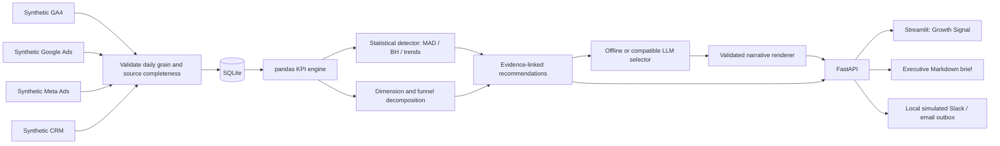

# AI Marketing Performance & Anomaly Detection Agent

**Growth Signal** is a practical marketing intelligence desk for a Head of Growth. It combines synthetic GA4, Google Ads, Meta Ads and CRM data, identifies statistically unusual performance changes, shows where changes came from, and turns evidence into an investigation queue and weekly executive brief.

It runs entirely offline by default. No marketing account, API key, Slack workspace or email server is needed.


## The business problem

Marketing teams see traffic, spend and pipeline in separate tools. A drop in conversions can lead to a premature budget decision when the real issue is measurement, a mobile conversion journey, or a different traffic mix. Growth Signal makes those distinctions visible before recommending an investigation.

The demo's final week has a paid-search mobile `/pricing` conversion decline, increased paid-search costs, and an improving email channel. A separate organic tracking discrepancy affects the previous comparison week. The product flags that measurement caution instead of calling the subsequent rebound a marketing win.

## Run locally

Use Python 3.11+; Python 3.12 is the Docker and CI target. Run commands from this project's directory.

```bash
python -m venv .venv
# Windows PowerShell
.venv\Scripts\Activate.ps1
# macOS / Linux: source .venv/bin/activate
pip install -r requirements.txt
cp .env.example .env
# Windows PowerShell: Copy-Item .env.example .env
python -m marketing_agent.cli --export-report
python -m uvicorn marketing_agent.api:app --host 127.0.0.1 --port 8001
```

In a second activated terminal:

```bash
python -m streamlit run dashboard/app.py --server.port 8502 --server.address 127.0.0.1
```

Open [the dashboard](http://localhost:8502) and [interactive API docs](http://localhost:8001/docs). Ports 8001 and 8502 let the project coexist with common development servers. Initial API startup automatically ingests the included sample CSVs into SQLite if the database is new. The CLI explicitly regenerates the demo and replaces its source tables; it preserves the alert outbox.

### Docker

```bash
docker compose up --build
```

This starts an API and dashboard with a health dependency, an unprivileged container user, localhost-only published ports and a persistent SQLite volume. The dashboard is available at the same address as above. Stop with `docker compose down`; data remains in the named volume. To regenerate the container demo: `docker compose exec api python -m marketing_agent.cli --export-report`, then restart the API to refresh its analysis cache. The image includes sample data but excludes secrets and local databases.

Docker configuration is supplied; image build/runtime verification requires Docker. Local Python runtime, API tests and dashboard smoke verification are recorded in [validation notes](docs/validation.md).

## Product walkthrough

| Page | Decision supported |
|---|---|
| Executive Overview | What changed this week, which channels contributed, and what needs attention? |
| Paid Media | Are CPC, CPA and attributed ROAS moving in the right direction? |
| Website | Which device and landing-page intersections explain the conversion change? |
| Funnel | Where do leads drop out, and how much pipeline comes from paid sources? |
| Anomalies | Which observations passed statistical thresholds? Inspect evidence and simulate alerts. |
| Recommendations | Review FACT / HYPOTHESIS / RECOMMENDATION cards with owner, priority and timeframe. |
| Weekly Report | Download a readable brief and its underlying JSON evidence. |

Use **Analysis ending** to replay earlier loaded dates. “This week” means the selected seven loaded days, compared with the preceding seven days, rather than a calendar week. A 63-day warm-up ensures sufficient baseline history. Every chart, report and answer uses the selected end date.

The analyst supports the three demo intents:

- “Why did conversions decline this week?” — overall website conversion comparison and contributing intersections.
- “Which channel had the biggest improvement?” — largest relative change in website conversions among channels without comparison-window measurement cautions.
- “What should we investigate first?” — evidence-linked measurement or performance investigation.

Questions about unloaded periods, unsupported metrics, scoped explanations or outside information receive a bounded response. This is a constrained analyst, not a general SQL chatbot.


## Architecture



```mermaid
sequenceDiagram
    participant User as Head of Growth
    participant UI as Dashboard
    participant API as FastAPI
    participant Engine as Analytics engine
    participant Model as Optional compatible LLM
    User->>UI: Select analysis date / ask a question
    UI->>API: Analysis or constrained query
    API->>Engine: Read validated synthetic sources
    Engine->>Engine: Aggregate counts, detect signals, decompose changes
    Engine-->>API: Facts, evidence IDs, hypotheses, recommendations
    opt LLM explicitly configured
        API->>Model: Evidence and approved narrative choices
        Model-->>API: JSON selection of approved IDs
        API->>API: Validate IDs; fall back on failure
    end
    API-->>UI: Rendered explanation and evidence
    UI-->>User: Decision brief and investigation queue
```

The dashboard consumes FastAPI rather than reimplementing calculations. Source tables are aggregated separately to a common date/dimension grain before combining counts. This prevents many-to-many joins and attribution double-counting. SQLite ingestion validates every source before a transaction replaces the tables. Analysis is cached by dataset version and end date; LLM calls happen only when a brief or conversion explanation is requested.

## Data and KPI definitions

The included [sample data](data/sample/manifest.json) has **120 contiguous days, June 3–September 30, 2026**, with a fixed seed, weekday traffic seasonality, random conversion variation, channel/device/page/geography mix and explicit demonstration incidents. CSV row counts: GA4 8,640; Google Ads 2,880; Meta Ads 2,880; CRM 8,640. Currency is USD. Each row's grain is date × channel × campaign × device × landing page × geography.

GA4 conversions are recorded website lead events. Google and Meta conversions are separately attributed platform events. CRM leads follow the synthetic underlying lead cohorts, including when the GA4 tracking event is missing. Ad revenue is never added to CRM revenue.

| KPI | Calculation | Scope |
|---|---|---|
| CTR | clicks / impressions | Google + Meta paid platforms |
| CPC | spend / clicks | Google + Meta |
| CPA | spend / platform conversions | Google + Meta |
| CAC | paid spend / paid-source CRM customers | Media-only acquisition cost |
| CVR | GA4 conversions / sessions | Website |
| ROAS | Google attributed revenue / Google spend | Google only; Meta revenue unavailable |
| Lead → MQL | MQLs / leads | CRM |
| MQL → SQL | SQLs / MQLs | CRM |
| Pipeline contribution | paid-source pipeline value / total pipeline value | CRM dollar contribution |

Rates are computed from summed numerators and denominators, never by averaging row rates. Zero denominators return `null` / N/A. Pipeline value is the modeled value of opportunities, not realized revenue. Summed users are **user-days**, not deduplicated unique people. Funnel stage cohorts are intentionally simplified to same-day snapshots; the project does not model actual sales-cycle delays.

Source validation rejects incomplete daily dimension coverage, missing dates, non-finite or negative metrics, duplicate grains, impossible website counts and non-nested CRM funnels. Source dates must align. No real-data upload or production connector is exposed.

## Statistical anomaly methodology

1. **Daily changes:** Compare an observation with the preceding 56 days on the same weekday (up to eight reference observations). At least six finite references are required. Only prior data enters the baseline.
2. **Robust baseline:** Expected value is the median. Scale is `1.4826 × median absolute deviation`. Count Poisson floors, rate binomial floors and a 5% scale floor for cost/revenue prevent tiny or zero variance from producing exaggerated significance.
3. **Materiality and volume:** Require `|z| ≥ 3.5`, at least 15% relative change, and a Benjamini–Hochberg adjusted approximate p-value ≤ 0.05. Conversion baselines below 15 and ratio denominators below 100 are screened out. Undefined ratios are excluded.
4. **Multiple comparisons:** BH correction is applied across all eligible metric/segment tests for each analyzed date, not just preselected outliers. The latest weekly comparison has its own BH family. Dimensions overlap, so alerts are correlated and are not independent incidents.
5. **Weekly changes:** Compare the latest complete seven-day aggregate with eight prior, non-overlapping seven-day aggregates (at least six references). Weekly rates are ratios of weekly sums. A statistical baseline is distinct from the prior-week comparison shown on KPI cards.
6. **Trends:** Regress six complete non-overlapping weekly channel CVRs against time; require ≥1,000 sessions per block, BH-adjusted p ≤0.05, ≥15% first-to-last change and R² ≥0.7. Label results as trends, not sudden anomalies.
7. **Tracking discrepancies:** Flag a channel when website recorded conversions fall below 30% of their same-weekday median while CRM leads stay within 70–130% of their baseline. This is a rule-based cross-source inconsistency, not proof that a tag failed.

The engine tests conversions, sessions, spend, CVR, CPC, CPA, CRM revenue and MQL → SQL across total, channel, campaign, device, landing page and geography. High severity means a relative effect ≥30%; medium is ≥15%. Tracking discrepancies are high severity. Default analysis shows the latest 21 days of daily evidence plus the latest weekly signals and trends.

Normal-tail p-values from robust scores are screening approximations, not calibrated causal probabilities or guaranteed false-positive rates. Overlapping dimensions, sparse references, temporal autocorrelation, strong trends and baseline contamination can affect them. The demo deliberately exposes the score, q-value, method, sample count and evidence ID so the findings can be reviewed.

## Root-cause analysis and interpretation

For conversion counts, each dimension's segment deltas sum exactly to the overall change. Channel, device and landing-page breakdowns describe the same records; they must not be added together.

The channel × device × landing-page intersection analysis separates volume and rate effects:

```text
traffic effect = (current sessions − prior sessions) × average of the two CVRs
rate effect    = (current CVR − prior CVR) × average of the two session counts
conversion change = traffic effect + rate effect
```

For overall CVR, each segment's weighted-rate delta is further split into within-segment rate and traffic-mix effects using symmetric decomposition. The Funnel page also shows changes in each stage's qualification rate and current dropoffs. These are descriptive contributors, not a claim of causal identification.

**FACT:** Numeric comparisons, detected signals and dimension contributions computed from loaded data.

**HYPOTHESIS:** Possible mechanisms, such as a page release, auction competition, audience saturation or tag mismatch. These are explicitly uncertain; the data does not contain release logs or auction diagnostics.

**RECOMMENDATION:** An evidence-linked investigation or controlled test, with a suggested owner and timeframe. No spend changes or external messages are executed.

## Explanation layer

`marketing_agent/llm.py` defines a provider protocol with offline and OpenAI-compatible implementations. Default explanations are deterministic and require no network connection. Optional mode calls `/chat/completions` on the configured base URL:

```dotenv
LLM_PROVIDER=compatible
LLM_BASE_URL=https://your-provider.example/v1
LLM_MODEL=your-model-name
LLM_API_KEY=your-key
LLM_TIMEOUT=20
```

Restart the API after changing settings. The endpoint must support chat completions with JSON-object output. Synthetic aggregate evidence is transmitted only when this mode is explicitly configured and an explanation is requested. Credentials stay on the API side; logs do not record prompts, response bodies or authorization headers.

To enforce grounded answers, the LLM **selects and orders approved evidence and hypothesis templates**, rather than writing unconstrained claims. The renderer owns every number and entity and always includes the factual overview. Unknown IDs, extra fields, invalid JSON, timeout and HTTP failures trigger an offline fallback. This intentionally trades narrative freedom for verifiability. AI interpretation never determines statistical findings or invents a proven cause.

## Example output

The included seed produces the final-week explanation:

> FACT: Website conversions decreased 9.9% versus the previous seven days; sessions changed −1.0%.
>
> FACT: Google Ads · Mobile · /pricing contributed −418 conversions to the week-over-week change; its CVR changed −76.7%.
>
> HYPOTHESIS: A landing-page, audience-quality or mobile UX change could explain the decline.

Recommended checks include conversion tracking reconciliation, page releases/form errors/mobile UX, campaign bids/search terms/audience frequency, and controlled experiments for the improving email channel. “Organic improved” is qualified by the tracking discrepancy and excluded from the winner ranking.

Inspect the generated [weekly brief](artifacts/weekly-report.md), [full statistical evidence](artifacts/analysis.json) and [simulated alert payloads](artifacts/simulated-alerts.json). Export again with `python -m marketing_agent.cli --export-report`.

## API and alerts

| Endpoint | Purpose |
|---|---|
| `GET /health` | Readiness and dataset fingerprint |
| `GET /analysis?end=2026-09-30` | KPIs, findings, contributions, funnel stages and actions |
| `GET /dimensions/{dimension}?metric=cvr` | Dimension decomposition; conversions or CVR |
| `GET /report?end=2026-09-30` | Explanation mode, notice and Markdown brief |
| `POST /query` | `{ "question": "Why did conversions decline this week?", "end": "2026-09-30" }` |
| `POST /alerts/simulate` | `{ "end": "2026-09-30" }`; preview and persist local alerts |
| `GET /alerts` | Read local outbox history |

Slack and email alerts are synthetic payloads persisted in SQLite, with evidence references and invalid/example recipients. There are no transport integrations or actual sends. A dataset fingerprint + finding ID + transport key deduplicates reruns. The demo selects up to eight high-severity weekly/tracking signals, producing at most sixteen payloads per analysis. Payloads can represent overlapping dimensions of the same incident.

## Tests and project structure

```bash
python -m pytest -q
# Optional UI smoke check while the API is running:
python scripts/smoke_dashboard.py
```

The suite covers all required KPI formulas, ratio aggregation, source separation, zero denominators, anomaly detection, multiple-comparison correction, sparse data, future-data isolation, tracking discrepancies, email trend detection, contribution reconciliation, recommendation grounding, bounded queries, provider fallback, ingestion integrity, API lifecycle and alert idempotency.

```text
marketing_agent/
  data.py             Seeded synthetic source adapters
  repository.py       Validation, transactional SQLite ingestion and outbox
  kpis.py             Count aggregation and KPI definitions
  anomalies.py        Statistical and discrepancy detectors
  root_cause.py       Dimension, intersection and funnel analysis
  recommendations.py  Evidence-linked investigation rules
  llm.py              Offline / compatible provider and validated renderer
  service.py          Reports, constrained queries and alert simulation
  api.py              FastAPI routes, logging, lifecycle and caching
  cli.py              Synthetic regeneration and artifact export
dashboard/app.py      Seven-page Streamlit product
data/sample/           Four CSVs and a synthetic-data manifest
tests/                pytest suite
scripts/              Dashboard smoke verification
artifacts/            Generated brief, evidence and local alert examples
docs/                 Screenshots and validation notes
Dockerfile
compose.yaml
.env.example
```

The GitHub Actions workflow is ready for this directory as a standalone repository. If retaining it in a larger repository, copy/adapt its workflow to the repository root with the appropriate working directory. No production authentication or multi-tenant isolation is included; serve this demo locally.

## Limitations and future integrations

Synthetic performance does not establish production effectiveness. The baseline is intentionally simple and not a forecasting model; correlation, mix changes and measurement issues require human review. The generator's tracking discrepancy has a deliberately clean GA4/CRM relationship, whereas real attribution windows and identity resolution differ. There is no scheduler: run the CLI or API to refresh a report, or add orchestration for scheduled reporting. Alerts are local and do not indicate delivery. CRM pipeline/customer attribution and media-only CAC are demonstration definitions.

Future adapters can extend the validated source contract:

- **GA4 Data API:** explicit conversion definitions, channel grouping, consent and timezone handling.
- **Google Ads:** campaign/ad-group detail, conversion windows, currencies and delayed attribution.
- **Meta Marketing API:** creative/audience performance, attributed revenue and account timezones.
- **HubSpot:** contact/deal cohort joins, stage timestamps, deduplication and closed-won attribution.
- **BigQuery:** incremental ingestion, partitioned facts, data-quality checks and warehouse-scale models.

Production work would also include credentials management, authorization, tenant isolation, late-arriving-data handling, calibrated detection/backtesting, incident grouping, richer metadata for causal investigation, a job scheduler and opt-in reviewed notification delivery.

Implementation references: [FastAPI lifespan testing](https://fastapi.tiangolo.com/advanced/testing-events/), [Streamlit chart API](https://docs.streamlit.io/develop/api-reference/charts/st.plotly_chart), and [SciPy multiple-testing correction](https://docs.scipy.org/doc/scipy/reference/generated/scipy.stats.false_discovery_control.html).
